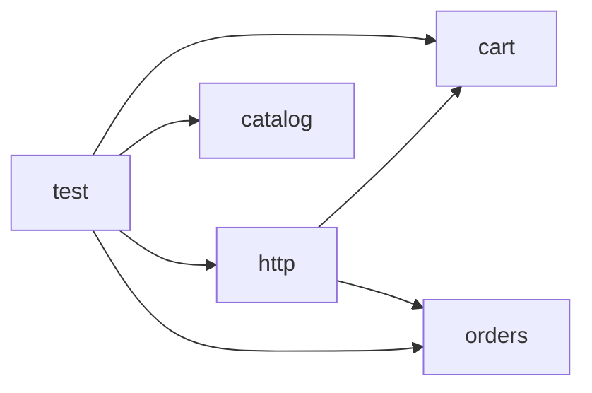

# Architecture

<!-- narrative -->
The shop is a small JavaScript project split into four source modules and one test module. The catalog module holds the in-memory product list keyed by SKU, and the cart module holds per-SKU quantities priced from the catalog. The orders module exposes a checkout function that takes a cart and an optional code. The http module contains createHandler, which takes the catalog and builds request handling on top of the cart and orders modules, so it is the only source module with dependencies on other modules. The test module sits at the top and exercises catalog, cart, orders and http directly. The catalog, cart and orders modules have no internal dependencies of their own.
<!-- /narrative -->

## Modules
- [cart](modules/cart.md)
- [catalog](modules/catalog.md)
- [http](modules/http.md)
- [orders](modules/orders.md)
- [test](modules/test.md)
