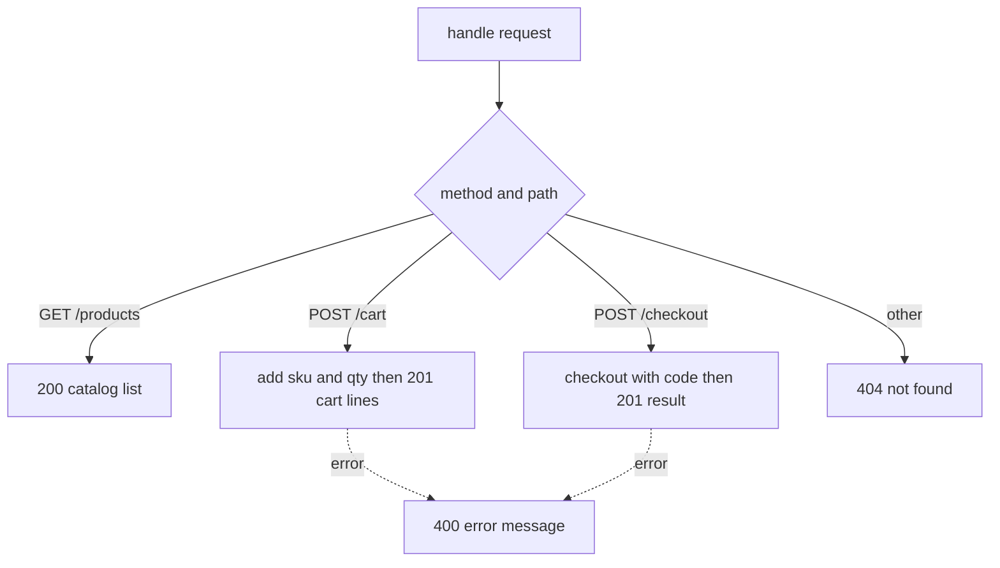

# http

## Purpose
<!-- purpose -->
The http module is a transport-agnostic router for the shop. It maps method and path pairs to shop operations (listing products, adding to a cart, checking out) and returns plain status and body objects, so it can be wired to any HTTP server or tested directly.
<!-- /purpose -->

## Public API
| Symbol | Kind | Signature |
|---|---|---|
| createHandler | function | export function createHandler(catalog) |

## Depends on
- [cart](cart.md)
- [orders](orders.md)

## Used by
- [test](test.md)

## How it works
<!-- how -->
createHandler(catalog) builds one Cart backed by the given catalog and returns a handle function that takes { method, path, body }. GET /products returns 200 with the catalog list. POST /cart adds body.sku and body.qty to the cart and returns 201 with the cart lines. POST /checkout runs the orders checkout function on the cart with body.code and returns 201 with the result. Any other route returns 404 with an error message. Exceptions thrown by any branch are caught and returned as 400 with the error message. The cart is shared across calls to the same handle function, so it is per handler instance rather than per request.

<!-- /how -->

## Why it is this way
_No rig changes recorded._
