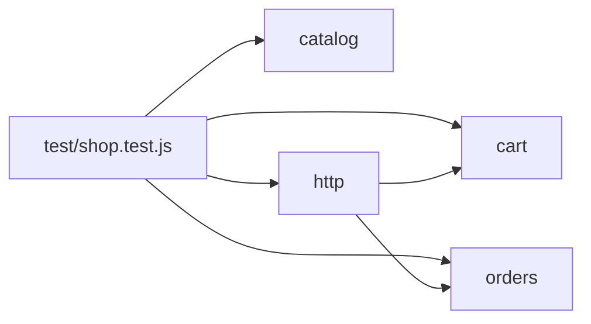

# test

## Purpose
<!-- purpose -->
Holds the node:test suite for the shop app. It exercises the catalog, cart, checkout and HTTP handler together, and it is the only module that depends on all four of them. Developers run it to check that the shop's core rules still hold.
<!-- /purpose -->

## Public API
_No exported symbols extracted._

## Depends on
- [cart](cart.md)
- [catalog](catalog.md)
- [http](http.md)
- [orders](orders.md)

## Used by
_none_

## How it works
<!-- how -->
All tests live in one file, test/shop.test.js, written with node:test and node:assert/strict. A helper builds a Catalog holding two products: TEA-001 at 450 cents and MUG-002 at 1200 cents. The first test checks that the catalog rejects a malformed SKU and a non-positive price. The second checks that the cart subtotal sums quantities and prices across repeated adds. The third checks that checkout applies the SAVE10 discount, rejects the unknown code FREE, and rejects an empty cart. The fourth checks that the HTTP handler lists products on GET /products, adds to the cart with POST /cart and returns 201, checks out with POST /checkout, and returns 400 for an unknown SKU.

<!-- /how -->

## Why it is this way
_No rig changes recorded._
